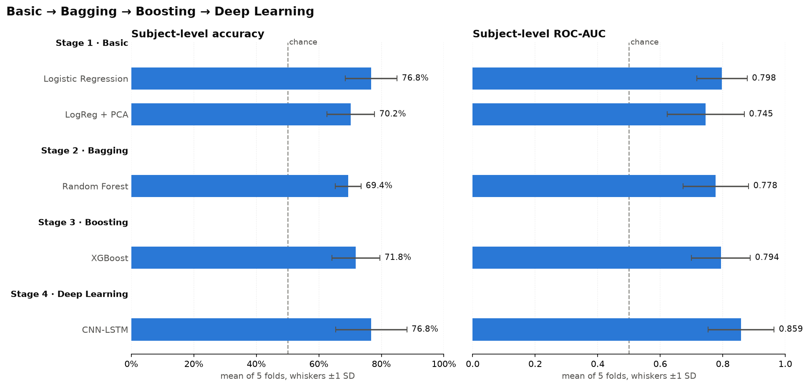

# ADHD Classification Using EEG Signals

**Mahim Katiyar** (102303958) · Thapar Institute of Engineering and Technology, Patiala

Can EEG recorded during a visual attention task distinguish people with ADHD from
controls? This project answers that with a four-stage model progression - a
linear baseline, then bagging, then boosting, then deep learning - evaluated
under one shared, leak-free protocol so every stage is directly comparable.



---

## Results

Five-fold cross-validation, **grouped by subject** so no person appears in both
training and test data. Each value is the mean across folds ± the standard
deviation across folds. *Subject-level* means one decision per person, made by
averaging that person's predictions over all of their 2-second EEG windows.

| Stage | Model | Subject accuracy | Subject ROC-AUC | Subject F1 | Epoch ROC-AUC |
|---|---|---|---|---|---|
| 1 · Basic | Logistic Regression | **76.8% ± 8.3** | 0.798 ± 0.081 | 0.788 | 0.729 |
| 1 · Basic | Logistic Regression + PCA | 70.2% ± 7.6 | 0.745 ± 0.124 | 0.730 | 0.667 |
| 2 · Bagging | Random Forest | 69.4% ± 4.1 | 0.778 ± 0.105 | 0.744 | 0.718 |
| 3 · Boosting | XGBoost | 71.8% ± 7.7 | 0.794 ± 0.094 | 0.760 | 0.730 |
| 4 · Deep Learning | CNN + LSTM | **76.8% ± 11.4** | **0.859 ± 0.105** | **0.791** | **0.834** |

Each test fold holds about 24 subjects, so **one subject is worth roughly 4
percentage points of accuracy**. Read small differences with that in mind.

## Key findings

**1. The CNN-LSTM is the strongest model, but not by a statistically significant
margin.** It has the highest subject ROC-AUC (0.859) and ties logistic regression
for accuracy. It beat logistic regression on 4 of the 5 folds, by +0.061 AUC on
average - but with only five folds that gain is not statistically significant
(paired t-test, p = 0.22). Its pooled predictions lean towards sensitivity: it
correctly identified 85% of ADHD subjects and 68% of controls.

**2. Bagging and boosting did not beat the linear baseline.** Random Forest and
XGBoost both landed within one standard deviation of logistic regression. With
121 subjects - about 97 per training fold - there is not enough independent data
for the extra capacity of tree ensembles to pay off. The roughly 13,000 training
windows are not 13,000 independent examples: windows from one person are near
duplicates of each other.

**3. PCA hurt.** Keeping 95% of the variance cost 6.6 points of accuracy. PCA
keeps the directions of highest *variance*, which need not be the directions
that separate the classes.

**4. Learning from the raw waveform paid off where hand-made features fell
short.** On fold 4, the CNN-LSTM scored 0.958 subject AUC while every
feature-based model stayed at or below 0.736 - those subjects carry information
that the band-power features do not capture.

**5. The fold-to-fold spread reflects the subjects, not the models.** Fold 3 was
the hardest fold for four of the five models. Which people land in the test set
moves the score more than the choice of model does, which is why every result
above is reported with its spread.

**6. In this dataset the theta/beta ratio points the "wrong" way.** The ADHD
group's ratio is *lower* than the controls' (median 2.8 vs 3.6, p = 0.009), the
opposite of the commonly quoted elevated theta/beta in ADHD. The marker's
reliability is disputed in the literature; this is one more data point for
reporting what the data shows rather than the textbook direction.

---

## Notebooks

Run them in order. `01` builds a cache that the rest load; `02`-`06` each write
their result to `results.csv`, which `07` reads. Every notebook explains what
each step does and why before the code.

| Notebook | Stage | What it does | Runtime (CPU) |
|---|---|---|---|
| `01_Data_and_Preprocessing.ipynb` | shared | inspect the data, 1-45 Hz filter, 2-s epochs, 456 features, sanity checks | ~2.5 min |
| `02_Logistic_Regression.ipynb` | 1 · Basic | linear baseline, coefficient plot | < 1 min |
| `03_Logistic_Regression_PCA.ipynb` | 1 · Basic | PCA to 95% variance before the baseline, scree plot | < 1 min |
| `04_Random_Forest.ipynb` | 2 · Bagging | 400-tree forest, feature importance | ~3 min |
| `05_XGBoost.ipynb` | 3 · Boosting | gradient boosting with early stopping, sensitivity and threshold checks | ~8 min |
| `06_CNN_LSTM.ipynb` | 4 · Deep Learning | convolution + LSTM over raw epochs, training curves | ~12 min |
| `07_Model_Comparison.ipynb` | summary | table, progression figure, fold-by-fold view, paired tests vs baseline | seconds |

## Pipeline

```
adhdata.csv  (2.16M rows: 19 channels at 128 Hz, 121 subjects)
   |
   |- per subject: 1-45 Hz Butterworth band-pass (zero-phase)
   |- 2-second windows, 50% overlap               ->  16,749 epochs
   |
   |- Stages 1-3: 456 hand-engineered features per epoch
   |     band power (delta, theta, alpha, beta, gamma; absolute + relative),
   |     theta/beta ratio, spectral entropy, edge frequencies,
   |     Hjorth parameters, statistical moments, zero crossings
   |     - computed for each of the 19 channels
   |
   '- Stage 4: raw epochs, shape (256 timesteps x 19 channels)
         |
         v
   5-fold StratifiedGroupKFold on subject ID
         |
         v
   epoch probabilities -> averaged per subject -> one decision per person
```

### Evaluation safeguards

- **No subject crosses a split.** Every notebook asserts this before training.
- **Scaling, PCA and early stopping are fitted on training data only.** Early
  stopping uses an inner validation split carved from the *training* subjects,
  never the test fold.
- **XGBoost's configuration is fixed in advance**, not selected by test score;
  two alternative configurations are reported as a sensitivity check.

## Architecture

Three parts: a shared preprocessing front end, a hand-made feature extractor
that feeds Stages 1-3, and five classifiers that all plug into the same
subject-grouped evaluation loop.

```
adhdata.csv
   |
   v
01 Preprocessing  ---------------------------->  data/epochs.npz
   band-pass, 2-s windows, feature extraction      Xr (16749, 256, 19)  raw epochs
                                                   Xf (16749, 456)      features
                                                   y, subject ID
         |                          |                           |
         v                          v                           v
   Stage 1 - Basic           Stage 2 / 3 - Trees          Stage 4 - Deep
   scale -> [PCA] -> LogReg  Random Forest / XGBoost      CNN + LSTM
   input: Xf                 input: Xf                    input: Xr
         |                          |                           |
         '--------------------------+---------------------------'
                                    v
              5-fold StratifiedGroupKFold, grouped by subject
              epoch P(ADHD) -> mean per subject -> one decision
                                    v
              results.csv / results_folds.csv  ->  07 Model comparison
```

### Preprocessing (notebook 01)

| Step | Setting |
|---|---|
| Band-pass filter | 4th-order Butterworth, 1-45 Hz, zero-phase (`sosfiltfilt`), applied per subject |
| Windowing | 2-second windows (256 samples), 1-second stride (50% overlap) |
| Labels and groups | one label per subject (ADHD = 1), subject ID kept with every epoch for grouping |
| Output | `data/epochs.npz`: raw epochs `Xr`, features `Xf`, labels `y`, subject IDs `g` |

### Feature extractor (Stages 1-3)

24 feature families, each computed on every one of the 19 channels, give
24 x 19 = 456 features per epoch. Spectral features come from a Welch power
spectrum over the full 2-second window.

| Family | Per channel | What it captures |
|---|---|---|
| Absolute band power | 5 (delta 1-4, theta 4-8, alpha 8-13, beta 13-30, gamma 30-45 Hz) | energy in each rhythm |
| Relative band power | 5 | the same, as a fraction of total 1-45 Hz power |
| Band ratios | 3 (theta/beta, (theta+alpha)/beta, alpha/beta) | the classic ADHD markers |
| Spectral entropy | 1 | how evenly power is spread across frequencies |
| Spectral edge frequency | 2 (50%, 95%) | frequency below which half / 95% of the power lies |
| Hjorth parameters | 3 (activity, mobility, complexity) | time-domain variance, mean frequency, bandwidth |
| Statistical | 5 (std, skewness, kurtosis, RMS, zero crossings) | amplitude distribution and waveform shape |

### Classical models (Stages 1-3)

Every model is refitted from scratch in each fold on that fold's training
epochs only. Scaling and PCA are part of the per-fold pipeline, so they never
see test data. All four use class weighting to offset the 56/44 epoch
imbalance.

| Stage | Model | Configuration |
|---|---|---|
| 1 - Basic | Logistic Regression | `StandardScaler` -> `LogisticRegression` (L2, C = 1, `class_weight="balanced"`, `max_iter=2000`) |
| 1 - Basic | Logistic Regression + PCA | `StandardScaler` -> `PCA(n_components=0.95)` (about 156 of 456 components kept) -> the same classifier |
| 2 - Bagging | Random Forest | 400 fully grown trees, `min_samples_leaf=2`, `class_weight="balanced"` |
| 3 - Boosting | XGBoost | up to 400 trees, `max_depth=6`, `learning_rate=0.1`, `subsample=0.9`, `colsample_bytree=0.9`, `tree_method="hist"`, `scale_pos_weight` = controls/ADHD; early stopping after 50 rounds without AUC gain on an inner validation split of 20% of the *training* subjects |

### CNN + LSTM (Stage 4)

The deep model skips the feature extractor and reads the filtered waveform
directly. Each epoch is z-scored per channel using the training fold's mean
and standard deviation, then enters the network as 256 time steps x 19
channels. Convolutions run *along time*, so each filter is a short waveform
detector applied across all 19 electrodes at once.

```
Input                                   (256, 19)
   |
Conv1D  64 filters, kernel 7, ReLU      (256, 64)       8,576 params
BatchNorm -> MaxPool 4 -> Dropout 0.3    (64, 64)
   |
Conv1D  64 filters, kernel 5, ReLU       (64, 64)      20,544 params
BatchNorm -> MaxPool 4 -> Dropout 0.3    (16, 64)
   |
LSTM    64 units, last hidden state      (64,)         33,024 params
Dropout 0.3
   |
Dense   32, ReLU -> Dropout 0.3          (32,)          2,080 params
   |
Dense   1, sigmoid                       P(ADHD)            33 params
                                                       --------------
                                                       64,769 params
                                                       (64,513 trainable)
```

- **Two convolution blocks** learn 64 short waveform patterns, then combine
  them into longer ones. Each max-pool shortens the sequence four-fold, so 256
  samples become 16 steps of 64 features.
- **The LSTM** reads those 16 steps in order and keeps a 64-number summary of
  how the patterns evolve over the 2 seconds. Pooling first is what makes the
  LSTM cheap enough to train on CPU.
- **A small dense head** turns the summary into a probability of ADHD.
- **Regularisation** is batch normalisation after each convolution and dropout
  of 0.3 after every block, because about 97 training subjects per fold is far
  less independent data than the network can memorise.

**Training, per fold.** Adam with learning rate 0.001, binary cross-entropy,
batch size 128, up to 40 epochs. 20% of the training *subjects* are held out
as an inner validation set (grouped, so no subject is split); training stops
when validation ROC-AUC has not improved for 8 epochs and the best-epoch
weights are restored. The test fold plays no part in choosing the stopping
point. Class weights are balanced from the training fold. With these settings
the five folds stopped after 30, 19, 21, 10 and 23 epochs.

## Dataset

- **121 participants:** 61 with ADHD, 60 controls
- **19 EEG channels**, international 10-20 system: Fp1, Fp2, F3, F4, C3, C4, P3,
  P4, O1, O2, F7, F8, T7, T8, P7, P8, Fz, Cz, Pz
- **128 Hz** sampling, recorded during a visual attention task
- Recording length ranges from about 62 to 338 seconds per subject

Source: the Kaggle dataset *EEG Dataset for ADHD* (file `adhdata.csv`). See
`Project dataset.pdf` for the original description. The data itself is not
redistributed in this repository.

---

## Revisions to the first version

An earlier version of this project reported 50% (Logistic Regression), 72%
(Random Forest) and 77% (CNN-LSTM) accuracy. Those numbers came from a protocol
with problems that made them unreliable, so they are not comparable to the
results above:

- **Subject leakage.** Rows were split at random, so samples from the same person
  appeared in both training and test data.
- **Wrong unit of prediction.** Each row was a single 7.8 ms sample, scored on its
  own. Diagnosis happens per person, and one 7.8 ms snapshot carries almost no
  signal - which is why logistic regression sat at chance.
- **The CNN-LSTM had no time axis.** Its input was reshaped to (19, 1), so the
  convolution and LSTM ran across the 19 *electrodes* rather than through time.
  It now reads (256 timesteps x 19 channels).
- **The test set chose the early-stopping epoch**, which biased the deep model's
  score upward.

The original notebooks remain in this repository's git history (commit
`18d26b2` and earlier).

## Running it

```bash
python -m venv .venv
.venv\Scripts\activate            # Windows   (macOS/Linux: source .venv/bin/activate)
pip install -r requirements.txt
python -m ipykernel install --user --name adhd-eeg --display-name "Python 3.12 (ADHD EEG)"
```

The last line registers the kernel the notebooks are saved with; any Python 3.12
kernel with these packages works just as well.

Place `adhdata.csv` in `data/`, then run the notebooks in order. Python 3.12;
the pinned versions in `requirements.txt` are the ones these results were
produced with.

## Repository layout

```
├── 01_Data_and_Preprocessing.ipynb    shared preprocessing, builds data/epochs.npz
├── 02_Logistic_Regression.ipynb       Stage 1 · Basic
├── 03_Logistic_Regression_PCA.ipynb   Stage 1 · Basic
├── 04_Random_Forest.ipynb             Stage 2 · Bagging
├── 05_XGBoost.ipynb                   Stage 3 · Boosting
├── 06_CNN_LSTM.ipynb                  Stage 4 · Deep Learning
├── 07_Model_Comparison.ipynb          side-by-side summary of all stages
├── results.csv                        5-fold summary per model (written by 02-06)
├── results_folds.csv                  per-fold scores (written by 02-06)
├── figures/model_progression.png      the figure at the top of this README
├── data/                              adhdata.csv and the cache - not in git
├── Project dataset.pdf                dataset description
└── requirements.txt
```

## Limitations and future work

- **Small sample.** 121 subjects makes every estimate noisy; the ± values above
  are wide because the data is limited, not because the pipeline is unstable.
- **One dataset, no external validation.** All results come from a single cohort
  and recording setup. How well they transfer to other sites and devices is
  untested.
- **Hyperparameters were not tuned with nested cross-validation.** A nested loop
  would remove any residual optimism from configuration choices.
- **No artefact removal beyond filtering.** ICA-based eye-blink removal is a
  natural next step, but it needs per-subject component review.
- **The deep model overfits hard.** Its training AUC reaches 1.0 within a few
  epochs while validation AUC plateaus around 0.75-0.88 (see the curves in
  `06`); early stopping and dropout are doing all the work. More independent
  subjects, data augmentation, or a smaller network are the levers.
- **Decision threshold fixed at 0.5.** `05` shows how to tune it on validation
  data; doing so for every model would trade sensitivity against specificity
  explicitly - important for any screening use.

## Technologies

Python 3.12 · NumPy · pandas · SciPy · scikit-learn · XGBoost · TensorFlow / Keras · Matplotlib · seaborn
